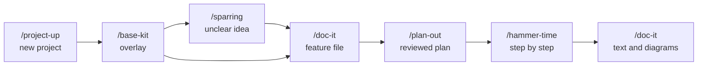

# forge

A lean engineering harness for Claude Code. It takes a feature from idea to plan, builds it step by step with proof at every step, gets independent tests and an independent review, and keeps the docs in line with the code.

## Install

In Claude Code:

```text
/plugin marketplace add HeidrichJannic/Forge
/plugin install forge@forge
```

Or in the shell:

```bash
claude plugin marketplace add HeidrichJannic/Forge
claude plugin install forge@forge
```

Then open a repository and run `/base-kit`.

Call every skill by its short name, e.g. `/plan-out`. The long form `/forge:plan-out` is only needed if another skill has the same name.

## Layout

```text
.claude-plugin/     marketplace.json, plugin.json (lists every skill)
skills/
  engineering/      project-up, base-kit, doc-it, plan-out, hammer-time, sus, brain-gain, health-check
  productivity/     sparring, tldr, wdym
agents/             tester, reviewer
core/               rules.md (core rules), asking.md
hooks/, scripts/    session hook
```

The repository root is the plugin. A new skill gets its own folder under `engineering/` or `productivity/` and a line in `plugin.json`.

## How it works

forge has two layers.

- **Core** – in this plugin, the same for every repository: core rules, skills, subagents, the session hook.
- **Overlay** – per repository, in `.forge/`, made by `/base-kit`.

The core rules are active only in a repository that has `.forge/context.md`. A session hook then adds them to the context, together with the state of the repository: the readiness, and the next open work item of the active plan. In other repositories forge adds nothing.

All skills run only when you call them. Their descriptions do not use context until then.

## Flow



0. **Start.** A new project starts with `/project-up`, then `/base-kit`. Without code, base-kit sets `bootstrap: true`, and the first forge plan builds the skeleton and the verify commands. An existing repository starts with `/base-kit`.
1. **Idea.** `/sparring` clarifies an unclear idea. `/doc-it` writes the feature file.
2. **Plan.** `/plan-out <feature file>` writes `.forge/plans/<date>-<slug>.md`: goal, scope, approach, acceptance criteria, and work items with test modes in phases that keep the build green. Three reviewers with fresh context challenge it: staff engineer, red team, and compliance if the feature touches personal data. You approve it.
3. **Build.** `/hammer-time <plan>` works through the work items. Per item: risk pass, tests from the independent tester, code, verify commands, tick in the plan, one commit. Each work item leaves the build green. It stops after each phase. At the end the independent reviewer checks the change, and you get a pull request description with the verify results and a verification guide.
4. **Docs.** `/doc-it` updates the docs, text and Mermaid diagrams.

## Lanes

Every change gets a lane first. The lane decides how much process it gets.

| Lane | Process |
| --- | --- |
| Trivial | Do it, verify. |
| Small | Short inline plan, build, verify, self-review with the checklist. |
| Medium | `/plan-out`, approval, `/hammer-time` with review. |
| Large | `/sparring` first, then medium. |

## Skills

| Skill | Purpose |
| --- | --- |
| `/project-up` | Plan a new project: idea, stack, conventions, folders, MVP. Writes `docs/`. |
| `/base-kit` | Create or update `.forge/`. Modes: `ready`, `baseline`, `constraint`, `exception`. |
| `/sparring` | Clarify a topic in question rounds. Summary in the chat. |
| `/doc-it` | Create or update docs for a topic, including Mermaid diagrams from the code, or compare all docs with the code. |
| `/plan-out` | Feature to reviewed implementation plan. |
| `/hammer-time` | Build a plan or a small change step by step. |
| `/sus` | Independent review of the current change. |
| `/health-check` | Read-only check: versions, verify commands, baseline, exceptions, plans, context against code. |
| `/brain-gain` | Third time the same correction: root cause, check or rule, regression check. |
| `/tldr` | Summarize the last message. |
| `/wdym` | Explain the last message in more depth. |

Subagents: `forge:tester` writes tests from the acceptance criteria, never from the implementer's reasoning. `forge:reviewer` reviews plans and changes read-only.

## Overlay files

| File | Holds | Who writes it |
| --- | --- | --- |
| `.forge/context.md` | Project facts as links to the docs, data protection, risk areas, verify commands, constraints, exceptions, readiness | `/base-kit`, and `/brain-gain` or the skeleton plan after your OK |
| `.forge/memory.md` | Your decisions, and counts of your corrections for the rule of three | Claude, when you decide or correct something |
| `.forge/baseline.md` | Known verify failures you accepted. A change never adds an entry. | Only you, through `/base-kit baseline` |
| `.forge/plans/` | Plans. The checkboxes are the build state. | `/plan-out`, `/hammer-time` |
| `.forge/learn/` | Proposals for changes to forge itself | `/brain-gain` |

## Readiness

`/base-kit ready` sets `ready` in `.forge/context.md`. With `ready: false` Claude takes only trivial and small lanes. `ready: true` needs the core context sections, working verify commands with no failure outside the baseline, and a matching forge version. After a plugin update the hook treats the repository as not ready until the next check.

## Update

Change the plugin in this repository, raise the version in `.claude-plugin/plugin.json`, add an entry to `CHANGELOG.md`, and push. Then run `/plugin marketplace update forge` in Claude Code. In each repository, `/health-check` shows what the new version changes, and `/base-kit` updates the overlay.

Never copy a forge skill into a repository. A copy with the same name loads next to the plugin skill, and the two drift apart. Put project rules into `CLAUDE.md`, and plugin changes into this repository through `/brain-gain` proposals.

`sparring`, `doc-it`, `project-up`, `tldr` and `wdym` live here now. Remove other copies of them, e.g. in `~/.claude/skills/`, so there is one source and the short names stay unique.

## License

[MIT](LICENSE)
